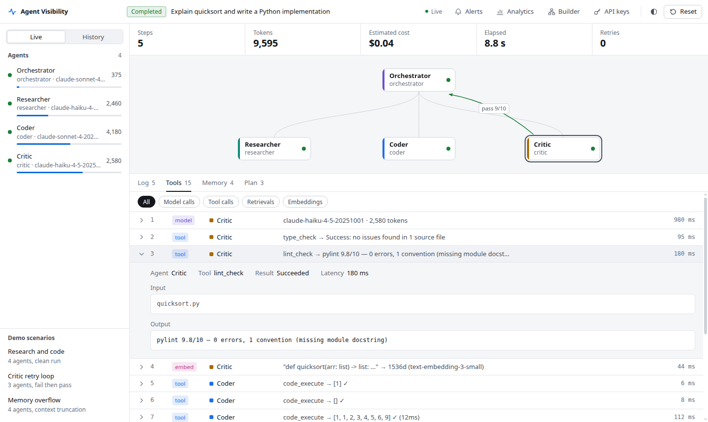
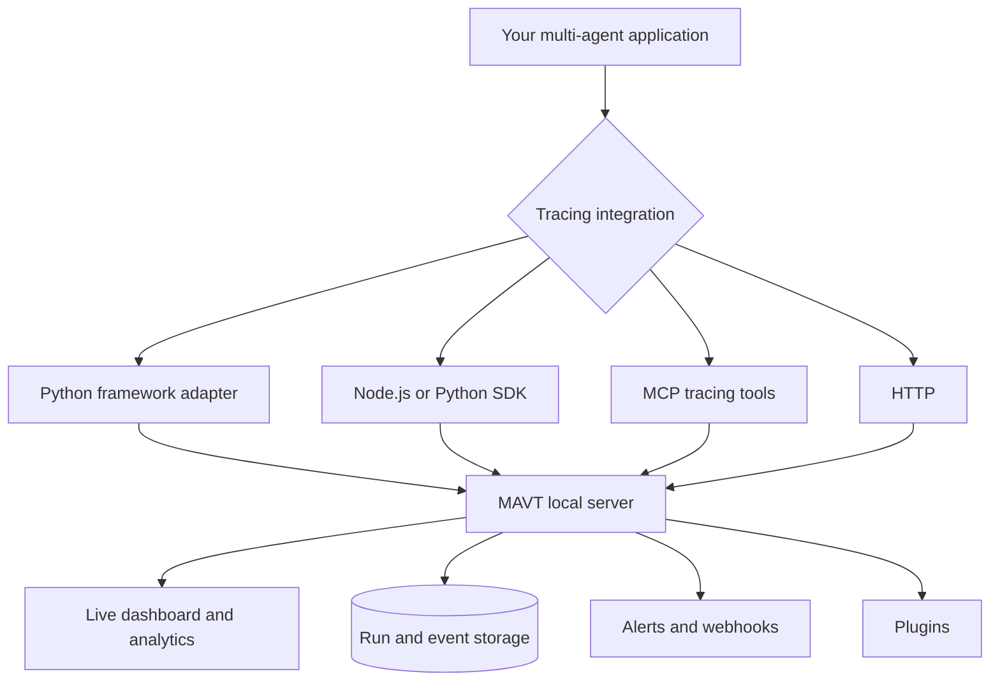

<p align="center">
  
</p>

<h1 align="center">🔍 MAVT — Multi-Agent Visibility Tool</h1>

<p align="center">
  <strong>The missing DevTools for multi-agent AI systems.</strong><br />
  Trace, visualize, and debug agent workflows in real time.
</p>

<p align="center">
  <a href="https://www.npmjs.com/package/agent-visibility"></a>
  <a href="https://github.com/hit1001/multiagent-visibility-tool/actions/workflows/ci.yml"></a>
  <a href="https://github.com/hit1001/multiagent-visibility-tool/stargazers"></a>
  <a href="https://github.com/hit1001/multiagent-visibility-tool/graphs/contributors"></a>
  <a href="./LICENSE"></a>
</p>

<p align="center">
  <a href="#-quick-start">Quick Start</a> ·
  <a href="#-features">Features</a> ·
  <a href="#-connect-your-agents">Connect your agents</a> ·
  <a href="#-documentation">Docs</a> ·
  <a href="#%EF%B8%8F-roadmap">Roadmap</a> ·
  <a href="#-contributing">Contributing</a>
</p>

---


> **You wouldn't ship a backend without logs. Why ship your agents blind?**

Debugging multi-agent workflows shouldn't mean guessing which agent failed, searching through
terminal output, or reconstructing conversations by hand. **MAVT** brings agent activity, model
calls, tool calls, handoffs, memory, cost and run history together in a local dashboard. It runs on
your machine, stores runs in a local SQLite file, and takes two lines to connect.

## 🎯 The Problem

Your multi-agent workflow produces an unexpected result. You need to know:

- **Which agent** failed, stalled, or returned the wrong information?
- **What context** did the model receive, and what did it generate?
- **Which handoff or tool call** caused a problem?
- **Where did the time, tokens and money go** during execution?

**MAVT helps you follow the execution trail instead of debugging blind.**

## ✨ Features

| Capability | What you can inspect |
| --- | --- |
| 🕸️ **Live topology graph** | Agents, who reports to whom, and the latest message between them, as events arrive |
| 🧠 **Model call inspector** | The messages sent, the response, thinking, token counts, latency and estimated cost, where instrumentation captures them |
| 🛠️ **Tool call traces** | Tool names, inputs, outputs, timing and reported errors |
| 🔎 **Agent details** | Click an agent to see its tokens, cost, budget use and everything it did |
| 🧩 **Event log, memory and plan** | What happened in order, instrumented memory reads and writes, and the plan's progress |
| 📜 **Run history & replay** | Search recorded runs, step through them event by event, compare two side by side, export as JSON |
| 💵 **Cost tracking & analytics** | Estimated cost per agent, model and run; latency averages and 95th percentiles; where the time goes |
| 🔔 **Alerts & webhooks** | Token or cost budget reached, agent stuck, critic failing, slow tools and runs; in the dashboard and to Slack, Discord or any webhook |
| 🧱 **Workflow builder** | Lay out a team of agents by drag and drop, register it on the dashboard, export the code |
| 🧪 **Plugins** | Your own JavaScript, called on runs, events and alerts |
| 🔌 **Many ways in** | Adapters for LangChain, AutoGen and CrewAI; SDKs for Node.js and Python; an MCP bridge; plain HTTP |
| 🔒 **Local-first** | Listens on your machine only by default; traces leave it only if you configure a webhook or install a plugin that sends them |

Light and dark themes follow your system setting.

| Tool calls, light theme | Analytics | Workflow builder |
|---|---|---|
| [](docs/images/dashboard-light.png) | [](docs/images/analytics.png) | [](docs/images/builder.png) |

> Cost tracking, analytics, the SDKs, the workflow builder, plugins, Docker support and the new
> interface were added after 0.5.0. If the npm release you have doesn't include them yet, install
> from this repository (see [Contributing](#-contributing)). The [changelog](CHANGELOG.md) lists
> what each release contains.

## 🚀 Quick Start

### Requirements

- **Node.js 22 or newer**, as specified by the package's `engines` field (Node 26 LTS recommended).
- **npm 11 or newer.** npm 12 blocks dependency install scripts unless you allow them.

### 1. Install

```bash
npm install -g agent-visibility --allow-scripts=better-sqlite3
```

`better-sqlite3` supplies the native SQLite persistence dependency, and `--allow-scripts` lets
npm 12 build it. If your npm version doesn't support that option, follow its normal install-script
approval process. In a clone of this repository the dependency is already approved in
`package.json`, so a plain `npm install` works.

### 2. Start the dashboard

```bash
agentscope
```

Open **http://localhost:4242**. The CLI also attempts to open the page automatically. Click
**Run a demo** to see what a traced run looks like.

> **Important:** Starting MAVT launches the dashboard; it does **not** automatically instrument an
> existing application. [Connect your agents](#-connect-your-agents) with an adapter, an SDK, the
> MCP bridge or HTTP to see your own runs.

New here? Follow the three short [tutorials](docs/README.md).

### CLI options

| Option | What it does |
|---|---|
| `--port <n>` | Dashboard port (default `4242`) |
| `--mcp` | Also start the MCP bridge on port `4243` |
| `--mcp-port <n>` | MCP bridge port (with `--mcp`) |
| `--no-open` | Don't open the browser automatically |
| `--host <addr>` | Listen address (default `127.0.0.1`; anything else needs `--password`) |
| `--password <pwd>` | Password-protect the dashboard |
| `--licence <key>` | Commercial licence key |
| `--help` | Show CLI help |

The command `visibility` is an alias for `agentscope`. Other settings, such as the data directory
and encryption key, are environment variables listed in [Deployment](docs/DEPLOYMENT.md#settings).

## 🧭 How it works



MAVT runs a local Node.js dashboard server. Adapters and SDKs send observed execution events to
it over HTTP; the optional MCP bridge exposes tools for MCP-compatible agents to report their
activity.

## 🔌 Connect your agents

Pick whichever fits your code. They all report the same events, and you can mix them.

### Framework adapters (Python)

The repository includes Python integrations for **LangChain**, **AutoGen** and **CrewAI**. These
are source adapters, not Python packages installed automatically by the npm CLI.

**Setup:** Copy [`mavt_client.py`](./adapters/mavt_client.py) **and** the adapter you want into
your Python project, in the same importable directory, and keep the MAVT dashboard running while
your workflow executes. If you installed from npm, the files are in
`$(npm root -g)/agent-visibility/adapters/`.

#### LangChain

**Files:** [`mavt_langchain.py`](./adapters/mavt_langchain.py) + [`mavt_client.py`](./adapters/mavt_client.py)  
**Dependencies:** `pip install langchain-core requests`

```python
from mavt_langchain import AgentscopeCallback

callback = AgentscopeCallback(goal="My task")

# Attach to your existing LangChain runnable or agent.
result = chain.invoke(input_data, config={"callbacks": [callback]})

callback.finish()
```

`chain` and `input_data` represent your existing LangChain application.

#### AutoGen

**Files:** [`mavt_autogen.py`](./adapters/mavt_autogen.py) + [`mavt_client.py`](./adapters/mavt_client.py)  
**Dependencies:** `pip install pyautogen requests` (or your supported `autogen-agentchat` version)

```python
from mavt_autogen import track

scope = track(agents=[orchestrator, researcher, coder], goal="My task")

# Run your existing AutoGen workflow here.

scope.finish()
```

#### CrewAI

**Files:** [`mavt_crewai.py`](./adapters/mavt_crewai.py) + [`mavt_client.py`](./adapters/mavt_client.py)  
**Dependencies:** `pip install crewai requests`

```python
from mavt_crewai import AgentscopeListener

listener = AgentscopeListener(goal="My task")

crew = Crew(
    agents=[researcher, coder, critic],
    tasks=[task1, task2],
    step_callback=listener,
    task_callback=listener.on_task_end,  # Optional
)

result = crew.kickoff()
listener.finish()
```

### SDKs (Node.js and Python)

For agents that don't use one of those frameworks. The Node.js SDK ships in the npm package:

```js
const { Visibility } = require('agent-visibility/sdk');
const vis = new Visibility();

vis.setGoal('My task');
vis.registerAgent({ id: 'lead', role: 'orchestrator', model: 'claude-sonnet-5-5' });
vis.logLlmTurn({ agent: 'lead', promptTokens: 1200, completionTokens: 300, response: text });
const rows = await vis.traceTool('lead', 'search', () => search(q), q);   // times it, records errors
vis.finishRun();
await vis.flush();
```

The Python SDK is [`mavt_sdk.py`](./adapters/mavt_sdk.py), with the same methods in snake_case.
See the [SDK guide](docs/SDK.md).

### MCP bridge (optional)

Run the dashboard and MCP server together:

```bash
agentscope --mcp
```

Then add this to your agent's MCP configuration:

```json
{ "mcpServers": { "agentscope": { "url": "http://localhost:4243/sse" } } }
```

The bridge exposes tools including `register_agent`, `set_goal`, `log_event`, `log_llm_turn`,
`trace_step`, `log_tool_call`, `set_memory` and `finish_run`.

> Connecting an MCP client makes the tools available; the client or application must still
> **call** them to report its activity. MCP transport support depends on the client.

### HTTP

Anything that can send HTTP can report events:

```bash
curl -X POST localhost:4242/tool -H 'Content-Type: application/json' \
  -d '{"tool":"set_goal","args":{"goal":"My task","run_id":"run-1"}}'
```

Every tool and endpoint is in the [API reference](docs/API.md). Saved runs can be downloaded from
the dashboard or from `GET /export/run/<id>` and `GET /export/runs`.

**Good to know for all of them**

- If the dashboard is password-protected, create a key under **API keys** in the dashboard and pass
  it as `api_key=` / `apiKey`, or set `VISIBILITY_API_KEY`.
- If the dashboard can't be reached, adapters and SDKs print one warning and stop sending. Your
  agents never wait on it and never fail because of it.
- Pass each agent's `model` so its calls can be priced.

## 💵 Cost tracking and analytics

The dashboard shows an estimated cost for the live run. **Analytics** in the top bar summarises
recent runs: cost and tokens per agent and model, tool error rates, latency averages and 95th
percentiles, and which agents or tools account for most of the time. The same data is available
as JSON from `GET /analytics`.

Cost is an estimate from list prices for Claude and common OpenAI models. It doesn't include
prompt-caching or batch discounts. Models that aren't in the price table, such as local or
fine-tuned ones, are counted as "not priced" until you add them to `pricing.json` in
`~/.agentscope/`. See [How cost is estimated](docs/API.md#how-cost-is-estimated).

## 🔔 Alerts & Webhooks

Set the rules under **Alerts** in the dashboard's top bar:

| Alert | Trigger |
| --- | --- |
| 💸 **Token budget** | Recorded usage crosses a configured percentage of an agent's budget (agents registered with `token_budget`) |
| 💵 **Cost budget** | A run's estimated cost reaches a configured amount (off until you set it) |
| ⏳ **Agent stuck** | An active agent is inactive beyond the configured duration |
| 🐢 **Slow tool call** | A tool call takes longer than the configured time (off until you set it) |
| ❌ **Critic failure rate** | Reported critic failures exceed a configured threshold |
| ⏱️ **Slow run** | A run takes much longer than recent runs |

MAVT displays alerts in the interface and POSTs them to a configured webhook URL, with formatted
messages for Slack and Discord webhooks. Rules are saved to `alerts.json` in `~/.agentscope/`.

## 🧱 Workflow builder

**Builder** in the top bar (or `/builder`) lets you lay out a team visually: drag roles onto a
canvas, draw who reports to whom, and set each agent's id, model and token budget. Then:

- **Apply to dashboard** registers the agents, so the team is on the graph before a run starts.
- **Export code** gives you the registration code for Node.js or Python, or the definition as JSON.

The builder describes your team; it does not run agents. Your own code does that and reports here.
See the [builder tutorial](docs/tutorials/03-workflow-builder.md).

## 🧪 Plugins

A plugin is a JavaScript file in `~/.agentscope/plugins/` that is called when a run starts or
finishes, on every reported event, and when an alert fires. Use one to write runs to a file,
forward them to another system, or add your own checks.

```js
module.exports = {
  name: 'my-plugin',
  onRunFinish({ runId, goal, status, metrics, durationMs }) { /* ... */ },
};
```

Two working examples are in [`examples/plugins/`](examples/plugins/). Plugins run inside the
dashboard with its permissions, so only install ones whose code you trust. Set
`VISIBILITY_PLUGINS=off` to load none. See [Plugins](docs/PLUGINS.md).

## 🔒 Local-First Operation and Security

Traces contain your prompts and model outputs, so the dashboard is locked down by default:

- **Local only.** It listens on `127.0.0.1`. For private local development, keep that default.
- **Sharing on a network.** Pass a host **and** a password; it refuses to start on a non-local
  address without one. Only do this when necessary, with a strong password and appropriate network
  protections.

  ```bash
  agentscope --host 0.0.0.0 --password "choose-a-strong-password"
  ```

- **No cross-site access.** Requests from other websites are rejected (no CORS, plus `Origin` and
  `Host` checks against DNS rebinding). To allow one specific browser origin, set
  `VISIBILITY_CORS_ORIGIN`.
- **Password mode.** The dashboard uses a session cookie (`HttpOnly`, `SameSite=Strict`). Logins
  expire after 12 hours, and ten failed attempts from one address lock it out for 15 minutes.
  Agents authenticate with API keys (`X-API-Key`), each with its own rate limit. The `--mcp` bridge
  is authenticated automatically and accepts local connections only.
- **Audit log.** Every reported event is recorded with the API key that sent it, along with
  logins, key changes, run deletions and settings changes (`GET /audit`).
- **Encryption at rest (optional).** Set `VISIBILITY_ENCRYPTION_KEY` to encrypt stored prompts and
  outputs with AES-256-GCM. Keep a copy of the key; encrypted runs can't be read without it.
- **Nothing phones home.** The dashboard loads no fonts, scripts or analytics from other sites,
  and licence keys are checked offline.

The server speaks plain HTTP. On a network you don't fully control, put it behind a reverse proxy
that terminates TLS. See [Deployment](docs/DEPLOYMENT.md#https).

## 🐳 Run it on a server

```bash
docker build -t agent-visibility .
docker run -d -p 4242:4242 -v mavt-data:/data \
  -e VISIBILITY_PASSWORD='choose-a-password' agent-visibility
```

The container won't start without a password. [Deployment](docs/DEPLOYMENT.md) covers Docker
Compose, HTTPS, encryption, AWS, Google Cloud, Azure, Hugging Face Spaces and backups.

## 📚 Documentation

| | |
|---|---|
| [Tutorials](docs/README.md) | First trace, budgets and analytics, the workflow builder |
| [SDKs](docs/SDK.md) | Node.js and Python |
| [HTTP API](docs/API.md) | Every tool and endpoint |
| [Plugins](docs/PLUGINS.md) | Hooks, examples, sharing a plugin |
| [Deployment](docs/DEPLOYMENT.md) | Docker, settings, HTTPS, encryption, cloud platforms |
| [Best practices](docs/BEST_PRACTICES.md) | Instrumenting agents and reading the numbers |
| [Changelog](CHANGELOG.md) | What changed in each release |

## 🗂️ Repository Structure

```text
multiagent-visibility-tool/
├── adapters/
│   ├── mavt_client.py        # Shared Python event client
│   ├── mavt_sdk.py           # Python SDK
│   ├── mavt_langchain.py     # LangChain callback adapter
│   ├── mavt_autogen.py       # AutoGen integration
│   └── mavt_crewai.py        # CrewAI integration
├── agentscope/
│   └── agentscope.js         # MCP bridge
├── bin/
│   └── visibility.js         # CLI entry point
├── src/
│   ├── server.js             # Dashboard server, alerts, HTTP API
│   ├── db.js                 # SQLite storage
│   ├── analytics.js          # Cost, usage and latency statistics
│   ├── pricing.js            # Model price table
│   ├── security.js           # Encryption at rest
│   ├── plugins.js            # Plugin loader
│   ├── workflows.js          # Workflow template validation
│   ├── sdk.js                # Node.js SDK
│   ├── dashboard.html        # Dashboard UI
│   ├── builder.html          # Workflow builder UI
│   ├── login.html            # Sign-in page
│   └── theme.css, icons.svg  # Shared design system
├── docs/                     # Guides, tutorials, API reference, screenshots
├── examples/plugins/         # Example plugins
├── test/                     # Node.js and Python tests
├── Dockerfile, docker-compose.yml
├── package.json
├── LICENSE
└── README.md
```

## 🛣️ Roadmap

**Available in the project:**

- [x] Live topology graph, model call inspector, tool call traces, memory panel
- [x] Run history, replay, comparison and export
- [x] LangChain, AutoGen and CrewAI adapters
- [x] MCP bridge
- [x] Alerts with Slack, Discord and webhook delivery
- [x] Password protection, API keys and audit log
- [x] Per-agent cost tracking and analytics
- [x] Node.js and Python SDKs
- [x] Docker image and encryption at rest
- [x] Workflow builder
- [x] Plugins
- [x] Light and dark themes

**Planned:**

- [ ] OpenTelemetry export
- [ ] Cloud-hosted dashboard

Have an integration idea? [Open an issue](https://github.com/hit1001/multiagent-visibility-tool/issues).

## 🤝 Contributing

Bug reports, documentation improvements, framework integrations, plugins and pull requests are
welcome. See [CONTRIBUTING.md](CONTRIBUTING.md).

To work on it locally (Node.js 22 or newer):

```bash
git clone https://github.com/hit1001/multiagent-visibility-tool
cd multiagent-visibility-tool
npm install
npm test                                   # server, database, security, SDK, builder and plugin tests
pip install langchain-core requests
python test/test_adapters.py               # Python adapters and SDK against a real server
npm run dev                                # dashboard on http://localhost:4242
```

CI runs both test suites and builds the Docker image on every pull request. See
[CHANGELOG.md](CHANGELOG.md) for release notes.

## 📄 License

MAVT is distributed under a **dual-license arrangement** (see [LICENSE](./LICENSE)):

- **Free (MIT terms):** individuals, teams under 10 people, open-source projects and evaluation.
- **Commercial licence:** organisations of 10 or more people, or use in a revenue-generating
  product or hosted service. To get one, open an issue or contact the authors.

**Please review the actual license before using MAVT, especially in commercial environments.** Its
additional restrictions mean the project should not be described simply as unmodified MIT-licensed
or OSI-approved open-source software.

Licence keys (`--licence MAVT-TEAM-YYYYMM-<signature>`) are Ed25519-signed and checked offline.
A licence also unlocks the aggregate metrics endpoint, `GET /api/v1/metrics`.

## 💬 Support

Questions, bug reports, or feature requests? [Open a GitHub issue](https://github.com/hit1001/multiagent-visibility-tool/issues).

---

<p align="center">
  <strong>Built with ❤️ by <a href="https://github.com/hit1001">Hitarth Bhatt</a> &amp; <a href="https://github.com/DheiryaBhatt">Dheirya Bhatt</a>.</strong>
</p>

<p align="center">
  If MAVT helps you debug your agents, consider <a href="https://github.com/hit1001/multiagent-visibility-tool">starring the repository ⭐</a>.
</p>
