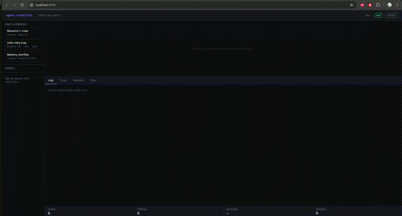

# 🔍 MAVT — Multi-Agent Visibility Tool

> The missing DevTools for multi-agent AI systems.

[](https://www.npmjs.com/package/agent-visibility)
[](LICENSE)
[](https://github.com/hit1001/multiagent-visibility-tool/actions/workflows/ci.yml)
[](https://github.com/hit1001/multiagent-visibility-tool/stargazers)



**You wouldn't ship a backend without logs. Why are you shipping agents blind?**

Multi-agent systems are the future of AI — but right now, debugging them feels like
reading smoke signals. MAVT gives you full observability: every agent call, every
decision step, every inter-agent message, visualized in real time.

---

## The problem

You build a multi-agent workflow. Something breaks. You ask yourself:

- Which agent failed — and why?
- What did agent A actually say to agent B?
- Where in the chain did the task go wrong?
- Why is this running so slow?

You open your terminal. You see... nothing useful.

**MAVT fixes this.**

---

## What you get

| | |
|---|---|
| 🔁 **Agent-to-agent traces** | See every message passed between agents, in order |
| 🧠 **LLM turn inspector** | Full prompt/response history with token counts and latency |
| 📊 **Live topology graph** | Visual execution graph, updating in real time |
| 🛠 **Tool call traces** | Every tool invocation, input, output, and duration |
| 🧩 **Memory panel** | Watch agent memory reads and writes as they happen |
| 📜 **Run history & replay** | Browse past runs and replay them step by step |
| 🔔 **Webhook alerts** | Get notified on token budget exceeded, agent stuck, critic failures, slow runs |
| 🔌 **MCP bridge** | Any MCP-capable agent can report to the dashboard without code changes |
| 🔒 **Local-first** | Runs on your machine and stores runs in local SQLite; traces never leave it unless you configure a webhook |

---

## Requirements

- **Node.js 22 or newer** (Node 26 LTS recommended). Node 20 reached end-of-life in April 2026 and is no longer supported.
- **npm 11+** (npm 12 recommended). On npm 12, dependency install scripts are blocked by default — allow the native SQLite build when installing globally:

```bash
npm install -g agent-visibility --allow-scripts=better-sqlite3
```

When working from a clone, `better-sqlite3` is already approved in `package.json` (`allowScripts`), so `npm install` builds it automatically. After a dependency upgrade, re-approve it with `npm install-scripts approve better-sqlite3`.

---

## Get started in 60 seconds

```bash
npm install -g agent-visibility --allow-scripts=better-sqlite3
agentscope
```

Open your browser → `http://localhost:4242`

Your agents are now fully observable. Click a demo scenario in the dashboard to see what a traced run looks like.

### CLI options

| Option | What it does |
|---|---|
| `--port <n>` | Dashboard port (default `4242`) |
| `--mcp` | Also start the MCP bridge on `:4243` |
| `--mcp-port <n>` | MCP bridge port |
| `--no-open` | Don't open the browser |
| `--host <addr>` | Listen address (default `127.0.0.1`; anything else needs `--password`) |
| `--password <pwd>` | Password-protect the dashboard |
| `--licence <key>` | Unlock the commercial data API |

### MCP

Start with `agentscope --mcp`, then add this to your agent's MCP config:

```json
{ "mcpServers": { "agentscope": { "url": "http://localhost:4243/sse" } } }
```

The agent gets tools such as `register_agent`, `set_goal`, `log_event`, `log_llm_turn`, `log_tool_call` and `finish_run`.

### HTTP

Anything that can send HTTP can report events:

```bash
curl -X POST localhost:4242/tool -H 'Content-Type: application/json' \
  -d '{"tool":"set_goal","args":{"goal":"My task","run_id":"run-1"}}'
```

Saved runs can be downloaded from the dashboard or from `GET /export/run/<id>` and `GET /export/runs`.

---

## Framework adapters

Drop-in Python adapters — two lines of code, full visibility.

The adapters are single files, not a pip package. Copy `mavt_client.py` plus the adapter you need from [`adapters/`](adapters/) into your project (`pip install requests`). If you installed from npm, they're in `$(npm root -g)/agent-visibility/adapters/`.

### LangChain

```python
from mavt_langchain import AgentscopeCallback   # pip install langchain-core

AgentExecutor(agent=agent, tools=tools,
              callbacks=[AgentscopeCallback(goal="My task")])
```

### AutoGen

```python
from mavt_autogen import track

scope = track(agents=[orchestrator, researcher, coder], goal="My task")
# ... run your agents ...
scope.finish()
```

### CrewAI

```python
from mavt_crewai import AgentscopeListener

listener = AgentscopeListener(goal="My task")
crew = Crew(agents=[...], tasks=[...], step_callback=listener)
result = crew.kickoff()
listener.finish()
```

If the dashboard is password-protected, create an API key in the dashboard's **Keys** panel and pass it as `api_key="mavt_sk_..."` to any adapter, or set `VISIBILITY_API_KEY`. If the dashboard isn't reachable, the adapter prints one warning and stops sending events for that run, so your agents never wait on it.

---

## Security

Traces contain your prompts and model outputs, so the dashboard is locked down by default:

- **Local only.** It listens on `127.0.0.1`. To share it on a network, pass `--host 0.0.0.0` **and** `--password <pwd>`; it refuses to start on a non-local address without a password.
- **No cross-site access.** Requests from other websites are rejected (no CORS, `Origin` and `Host` checks against DNS rebinding). To allow one specific browser origin, set `VISIBILITY_CORS_ORIGIN`.
- **Password mode.** `--password` protects the dashboard (session cookie, `HttpOnly`, `SameSite=Strict`); agents authenticate with API keys (`X-API-Key`). The `--mcp` bridge is authenticated automatically.
- **MCP bridge** (`:4243`) accepts local connections only.

---

## Licensing

MAVT is dual-licensed (see [LICENSE](LICENSE)):

- **Free (MIT):** individuals, teams under 10 people, open source, evaluation.
- **Commercial licence:** organisations of 10+ people, or use in a revenue-generating product or hosted service. To get one, open an issue or email the author.

Licence keys (`--licence MAVT-TEAM-YYYYMM-<signature>`) are Ed25519-signed and checked offline; nothing phones home.

---

## Webhook alerts

Configure alerts directly from the dashboard sidebar:

| Alert | Trigger |
|---|---|
| 💸 Token budget | Agent uses ≥ X% of its token budget (only for agents registered with `token_budget`) |
| ⏳ Agent stuck | A running agent is silent for more than N seconds |
| ❌ Critic fail rate | Critic failure rate exceeds X% |
| ⏱️ Slow run | A run takes much longer than recent runs |

Alerts appear as toast notifications in the UI and are POSTed to any webhook URL you configure; Slack and Discord webhooks get formatted messages. Settings are saved to `~/.agentscope/alerts.json`.

---

## Why observability is non-negotiable

> *"If you can't measure it, you can't manage it."*

AI agents are making real decisions in production systems today — in customer service,
in code generation, in enterprise workflows. Without visibility:

- You can't debug failures
- You can't trust outputs
- You can't scale safely
- You can't explain decisions to stakeholders

MAVT is the foundation layer your agent stack is missing.

---

## Roadmap

- [x] Live topology graph
- [x] LLM turn inspector
- [x] Tool call traces
- [x] Memory panel
- [x] Run history & replay
- [x] LangChain adapter
- [x] AutoGen adapter
- [x] CrewAI adapter
- [x] Webhook alerts
- [x] MCP bridge
- [x] Password protection, API keys and audit log
- [x] Run export
- [ ] OpenTelemetry export
- [ ] Cloud-hosted dashboard
- [ ] Cost tracking per agent

---

## Contributing

Issues, PRs, and framework integrations are very welcome.
If you're using MAVT with a framework not listed above — open an issue and let's add it.

To work on it locally (Node 22+):

```bash
git clone https://github.com/hit1001/multiagent-visibility-tool
cd multiagent-visibility-tool
npm install
npm test                                   # server, database, licence and security tests
pip install langchain-core requests
python test/test_adapters.py               # Python adapters against a real server
npm run dev                                # dashboard on :4242
```

CI runs both test suites on every pull request. See [CHANGELOG.md](CHANGELOG.md) for release notes.

---

## Star history

If MAVT saves you a debugging session, consider leaving a ⭐ —
it helps other developers find the tool.

---

## About the author

Built by [Hitarth Bhatt](https://github.com/hit1001) — AI product leader with 10+ years
shipping AI systems at scale. MAVT grew out of a real frustration: the more powerful
multi-agent systems become, the harder they are to see inside.

---

**Dual License** · [npm](https://www.npmjs.com/package/agent-visibility) · [Issues](https://github.com/hit1001/multiagent-visibility-tool/issues)
