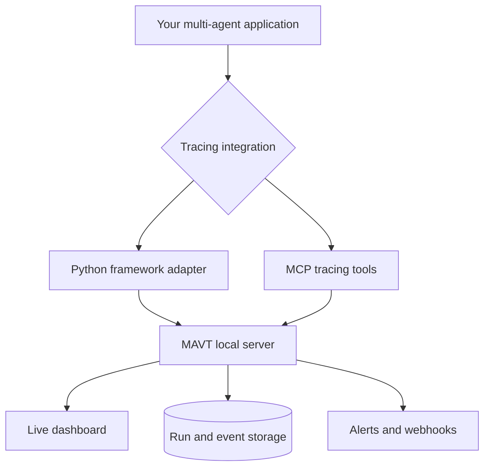

<p align="center">
  
</p>

<h1 align="center">🔍 MAVT — Multi-Agent Visibility Tool</h1>

<p align="center">
  <strong>The missing DevTools for multi-agent AI systems.</strong><br />
  Trace, visualize, and debug agent workflows in real time.
</p>

<p align="center">
  <a href="https://www.npmjs.com/package/agent-visibility"></a>
  <a href="https://github.com/hit1001/multiagent-visibility-tool/stargazers"></a>
  <a href="https://github.com/hit1001/multiagent-visibility-tool/graphs/contributors"></a>
  <a href="./LICENSE"></a>
</p>

<p align="center">
  <a href="#-quick-start">Quick Start</a> ·
  <a href="#-features">Features</a> ·
  <a href="#-framework-adapters">Adapters</a> ·
  <a href="#-optional-mcp-bridge">MCP Bridge</a> ·
  <a href="#-roadmap">Roadmap</a> ·
  <a href="#-contributing">Contributing</a>
</p>

---

[](https://www.npmjs.com/package/agent-visibility)
[](LICENSE)
[](https://github.com/hit1001/multiagent-visibility-tool/actions/workflows/ci.yml)
[](https://github.com/hit1001/multiagent-visibility-tool/stargazers)

> **You wouldn't ship a backend without logs. Why ship your agents blind?**

Debugging multi-agent workflows shouldn't mean guessing which agent failed, searching through terminal output, or reconstructing conversations by hand. **MAVT** brings agent activity, LLM turns, tool calls, handoffs, memory, and run history together in a local dashboard.

## 🎯 The Problem

Your multi-agent workflow produces an unexpected result. You need to know:

- **Which agent** failed, stalled, or returned the wrong information?
- **What context** did the model receive, and what did it generate?
- **Which handoff or tool call** caused a problem?
- **Where did the time and tokens go** during execution?

**MAVT helps you follow the execution trail instead of debugging blind.**

## ✨ Features

| Capability | What you can inspect |
| --- | --- |
| 🕸️ **Live topology graph** | Agent relationships and execution flow as events arrive |
| 🔁 **Inter-agent traces** | Messages, handoffs, and transitions between agents |
| 🧠 **LLM turn inspector** | Prompts, responses, token counts, and latency where instrumentation captures them |
| 🛠️ **Tool call traces** | Tool names, inputs, outputs, timing, and reported errors |
| 🧩 **Memory panel** | Instrumented memory reads and writes |
| 📜 **Run history & replay** | Inspect recorded runs and step through prior events |
| 🔔 **Alerts & webhooks** | Monitor token budgets, inactivity, and critic failures |
| 🔌 **MCP bridge** | Send tracing events from MCP-compatible agents and clients |

## 🚀 Quick Start

### Requirements

- **Node.js 22 or newer**, as specified by the package's `engines` field.
- **npm** (npm 11+ recommended; npm 12 may require explicit approval of dependency install scripts).

| | |
|---|---|
| 🔁 **Agent-to-agent traces** | See every message passed between agents, in order |
| 🧠 **LLM turn inspector** | Full prompt/response history with token counts and latency |
| 📊 **Live topology graph** | Visual execution graph, updating in real time |
| 🛠 **Tool call traces** | Every tool invocation, input, output, and duration |
| 🧩 **Memory panel** | Watch agent memory reads and writes as they happen |
| 📜 **Run history & replay** | Browse past runs and replay them step by step |
| 🔔 **Webhook alerts** | Get notified on token budget exceeded, agent stuck, critic failures, slow runs |
| 🔌 **MCP bridge** | Any MCP-capable agent can report to the dashboard without code changes |
| 🔒 **Local-first** | Runs on your machine and stores runs in local SQLite; traces never leave it unless you configure a webhook |

```bash
npm install -g agent-visibility --allow-scripts=better-sqlite3
```

`better-sqlite3` supplies the native SQLite persistence dependency. On npm versions that block install scripts by default, the `--allow-scripts` option permits that dependency to build. If your npm version does not support this option, follow its normal install-script approval process.

### 2. Start the dashboard

```bash
agentscope
```

Open **http://localhost:4242**. The CLI also attempts to open the page automatically.

> **Important:** Starting MAVT launches the dashboard; it does **not** automatically instrument an existing application. Connect a framework adapter or have an MCP client send tracing events to see your own runs.

### Useful CLI options

```bash
agentscope --no-open               # Do not open the browser automatically
agentscope --port 5000             # Change the dashboard port
agentscope --mcp                   # Start the dashboard and MCP bridge
agentscope --mcp-port 5001         # Change the MCP bridge port (with --mcp)
agentscope --help                  # Show CLI help
```

The command `visibility` is also provided as an alias for `agentscope`.

Your agents are now fully observable. Click a demo scenario in the dashboard to see what a traced run looks like.

### CLI options

| Option | What it does |
|---|---|
| `--port <n>` | Dashboard port (default `4242`) |
| `--mcp` | Also start the MCP bridge on `:4243` |
| `--mcp-port <n>` | MCP bridge port |
| `--no-open` | Don't open the browser |
| `--host <addr>` | Listen address (default `127.0.0.1`; anything else needs `--password`) |
| `--password <pwd>` | Password-protect the dashboard |
| `--licence <key>` | Unlock the commercial data API |

### MCP

Start with `agentscope --mcp`, then add this to your agent's MCP config:

```json
{ "mcpServers": { "agentscope": { "url": "http://localhost:4243/sse" } } }
```

The agent gets tools such as `register_agent`, `set_goal`, `log_event`, `log_llm_turn`, `log_tool_call` and `finish_run`.

### HTTP

Anything that can send HTTP can report events:

```bash
curl -X POST localhost:4242/tool -H 'Content-Type: application/json' \
  -d '{"tool":"set_goal","args":{"goal":"My task","run_id":"run-1"}}'
```

Saved runs can be downloaded from the dashboard or from `GET /export/run/<id>` and `GET /export/runs`.



MAVT runs a local Node.js dashboard server. Python adapters send observed execution events to it; the optional MCP bridge exposes tools for MCP-compatible agents to report their activity.

## 🔌 Framework Adapters

The repository includes Python integrations for **LangChain**, **AutoGen**, and **CrewAI**. These are source adapters, not Python packages installed automatically by the npm CLI.

**Setup:** Copy [`mavt_client.py`](./adapters/mavt_client.py) **and** the adapter you want into your Python project (in the same importable directory). Install the required Python dependencies for your framework, and keep the MAVT dashboard running while your workflow executes.

The adapters are single files, not a pip package. Copy `mavt_client.py` plus the adapter you need from [`adapters/`](adapters/) into your project (`pip install requests`). If you installed from npm, they're in `$(npm root -g)/agent-visibility/adapters/`.

### LangChain

**Files:** [`mavt_langchain.py`](./adapters/mavt_langchain.py) + [`mavt_client.py`](./adapters/mavt_client.py)  
**Dependencies:** `pip install langchain-core requests`

```python
from mavt_langchain import AgentscopeCallback   # pip install langchain-core

# Attach to your existing LangChain runnable or agent.
result = chain.invoke(input_data, config={"callbacks": [callback]})

callback.finish()
```

`chain` and `input_data` represent your existing LangChain application.

### AutoGen

**Files:** [`mavt_autogen.py`](./adapters/mavt_autogen.py) + [`mavt_client.py`](./adapters/mavt_client.py)  
**Dependencies:** `pip install pyautogen requests` (or your supported `autogen-agentchat` version)

```python
from mavt_autogen import track

scope = track(agents=[orchestrator, researcher, coder], goal="My task")

# Run your existing AutoGen workflow here.

scope.finish()
```

### CrewAI

**Files:** [`mavt_crewai.py`](./adapters/mavt_crewai.py) + [`mavt_client.py`](./adapters/mavt_client.py)  
**Dependencies:** `pip install crewai requests`

```python
from mavt_crewai import AgentscopeListener

listener = AgentscopeListener(goal="My task")

crew = Crew(
    agents=[researcher, coder, critic],
    tasks=[task1, task2],
    step_callback=listener,
    task_callback=listener.on_task_end,  # Optional
)

result = crew.kickoff()
listener.finish()
```

If the dashboard is password-protected, create an API key in the dashboard's **Keys** panel and pass it as `api_key="mavt_sk_..."` to any adapter, or set `VISIBILITY_API_KEY`. If the dashboard isn't reachable, the adapter prints one warning and stops sending events for that run, so your agents never wait on it.

---

## Security

Traces contain your prompts and model outputs, so the dashboard is locked down by default:

- **Local only.** It listens on `127.0.0.1`. To share it on a network, pass `--host 0.0.0.0` **and** `--password <pwd>`; it refuses to start on a non-local address without a password.
- **No cross-site access.** Requests from other websites are rejected (no CORS, `Origin` and `Host` checks against DNS rebinding). To allow one specific browser origin, set `VISIBILITY_CORS_ORIGIN`.
- **Password mode.** `--password` protects the dashboard (session cookie, `HttpOnly`, `SameSite=Strict`); agents authenticate with API keys (`X-API-Key`). The `--mcp` bridge is authenticated automatically.
- **MCP bridge** (`:4243`) accepts local connections only.

---

## Licensing

MAVT is dual-licensed (see [LICENSE](LICENSE)):

- **Free (MIT):** individuals, teams under 10 people, open source, evaluation.
- **Commercial licence:** organisations of 10+ people, or use in a revenue-generating product or hosted service. To get one, open an issue or email the author.

Licence keys (`--licence MAVT-TEAM-YYYYMM-<signature>`) are Ed25519-signed and checked offline; nothing phones home.

---

## 🔗 Optional MCP Bridge

Run the dashboard and MCP server together:

| Alert | Trigger |
|---|---|
| 💸 Token budget | Agent uses ≥ X% of its token budget (only for agents registered with `token_budget`) |
| ⏳ Agent stuck | A running agent is silent for more than N seconds |
| ❌ Critic fail rate | Critic failure rate exceeds X% |
| ⏱️ Slow run | A run takes much longer than recent runs |

Alerts appear as toast notifications in the UI and are POSTed to any webhook URL you configure; Slack and Discord webhooks get formatted messages. Settings are saved to `~/.agentscope/alerts.json`.

The bridge exposes tools including `register_agent`, `log_event`, `log_llm_turn`, `trace_step`, `log_tool_call`, `set_memory`, and `finish_run`.

> Connecting an MCP client makes the tools available; the client or application must still **call** them to report its activity. MCP transport support depends on the client.

## 🔔 Alerts & Webhooks

Configure alerts in the dashboard to monitor instrumented activity:

| Alert | Trigger |
| --- | --- |
| 💸 **Token budget** | Recorded usage crosses a configured percentage of a tracked budget |
| ⏳ **Agent stuck** | An active agent is inactive beyond the configured duration |
| ❌ **Critic failure rate** | Reported critic failures exceed a configured threshold |

MAVT can display alerts in the interface and POST notifications to configured webhook URLs, including supported Slack and Discord webhook formats.

## 🔒 Local-First Operation

By default, MAVT runs on the local machine. The CLI also supports a custom host and password:

```bash
agentscope --host 0.0.0.0 --password "choose-a-strong-password"
```

Only bind the server to a network interface when necessary; use a strong password and appropriate network protections. For private local development, prefer the default loopback-only setup.

## 🗂️ Repository Structure

```text
multiagent-visibility-tool/
├── adapters/
│   ├── mavt_client.py        # Shared Python event client
│   ├── mavt_langchain.py     # LangChain callback adapter
│   ├── mavt_autogen.py       # AutoGen integration
│   └── mavt_crewai.py        # CrewAI integration
├── agentscope/
│   └── agentscope.js         # MCP bridge
├── bin/
│   └── visibility.js        # CLI entry point
├── src/                      # Dashboard server, data, UI, alerts
├── demo.gif                  # Dashboard demo
├── package.json
├── LICENSE
└── README.md
```

## 🛣️ Roadmap

**Available in the project:**

- [x] Live topology graph
- [x] LLM turn inspector
- [x] Tool call traces
- [x] Memory panel
- [x] Run history & replay
- [x] LangChain adapter
- [x] AutoGen adapter
- [x] CrewAI adapter
- [x] Webhook alerts
- [x] MCP bridge
- [x] Password protection, API keys and audit log
- [x] Run export
- [ ] OpenTelemetry export
- [ ] Cloud-hosted dashboard
- [ ] Per-agent cost tracking

Have an integration idea? [Open an issue](https://github.com/hit1001/multiagent-visibility-tool/issues).

## 🤝 Contributing

Bug reports, documentation improvements, framework integrations, and pull requests are welcome.

To work on it locally (Node 22+):

```bash
git clone https://github.com/hit1001/multiagent-visibility-tool
cd multiagent-visibility-tool
npm install
npm test                                   # server, database, licence and security tests
pip install langchain-core requests
python test/test_adapters.py               # Python adapters against a real server
npm run dev                                # dashboard on :4242
```

CI runs both test suites on every pull request. See [CHANGELOG.md](CHANGELOG.md) for release notes.

---

## 📄 License

MAVT is distributed under a **dual-license arrangement**. The [LICENSE](./LICENSE) file sets out free-use categories for individuals, small teams, open-source projects, and evaluation, alongside commercial licensing requirements for certain organizations and use cases.

**Please review the actual license before using MAVT, especially in commercial environments.** Its additional restrictions mean the project should not be described simply as unmodified MIT-licensed or OSI-approved open-source software.

## 💬 Support

Questions, bug reports, or feature requests? [Open a GitHub issue](https://github.com/hit1001/multiagent-visibility-tool/issues).

---

<p align="center">
  <strong>Built with ❤️ by <a href="https://github.com/hit1001">Hitarth Bhatt</a> &amp; <a href="https://github.com/DheiryaBhatt">Dheirya Bhatt</a>.</strong>
</p>

<p align="center">
  If MAVT helps you debug your agents, consider <a href="https://github.com/hit1001/multiagent-visibility-tool">starring the repository ⭐</a>.
</p>
