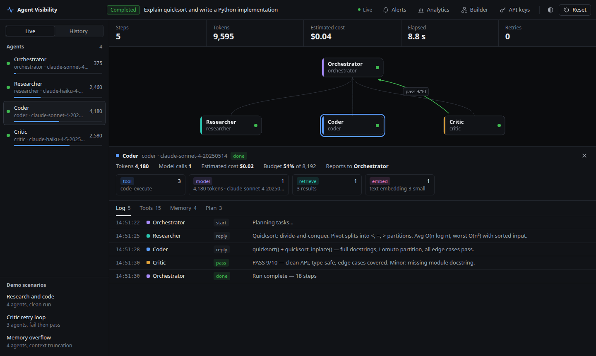
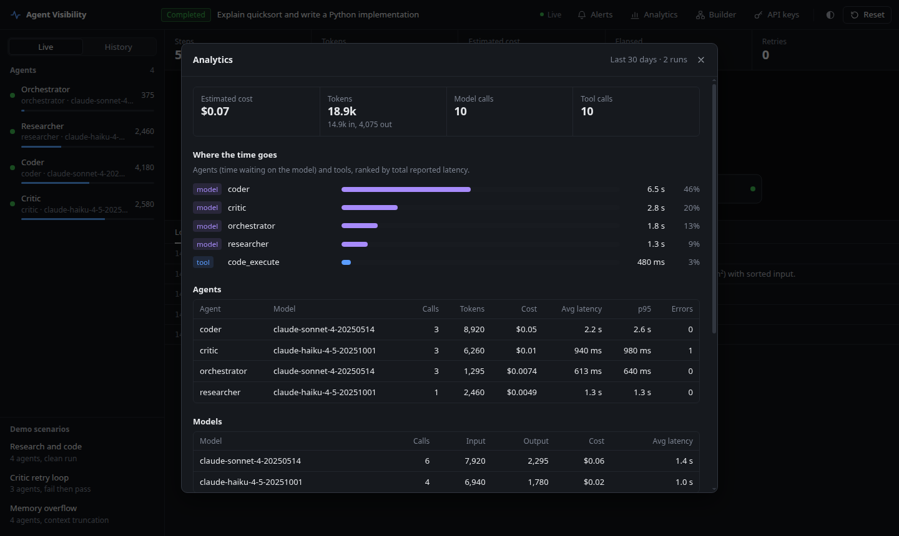
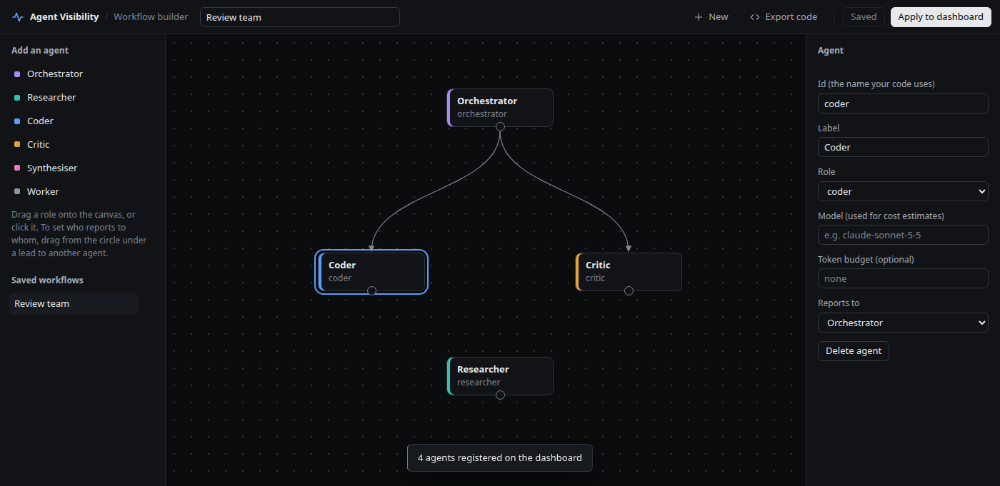

# MAVT — Multi-Agent Visibility Tool

> The missing DevTools for multi-agent AI systems.

[](https://www.npmjs.com/package/agent-visibility)
[](LICENSE)
[](https://github.com/hit1001/multiagent-visibility-tool/actions/workflows/ci.yml)
[](https://github.com/hit1001/multiagent-visibility-tool/stargazers)



**You wouldn't ship a backend without logs. Why are you shipping agents blind?**

MAVT is a local dashboard that shows what your agents are doing while they do it: who called
whom, what each model call contained, which tools ran, what it cost, and where the time went.
It runs on your machine, stores runs in a local SQLite file, and takes two lines to connect.

---

## The problem

You build a multi-agent workflow. Something breaks. You ask yourself:

- Which agent failed, and why?
- What did agent A actually say to agent B?
- Where in the chain did the task go wrong?
- Why is this run slow, and why did it cost so much?

You open your terminal. You see nothing useful. MAVT answers those questions.

---

## What you get

| | |
|---|---|
| **Live agent graph** | Agents, who reports to whom, and the latest message between them, updating as the run proceeds |
| **Model call inspector** | The messages sent, the response, thinking, token counts, latency and estimated cost of every call |
| **Tool call traces** | Every tool invocation with its input, output, duration and errors |
| **Agent details** | Click an agent to see its tokens, cost, budget use and everything it did |
| **Event log, memory and plan** | What happened in order, what was read and written to shared memory, and the plan's progress |
| **Run history and replay** | Search past runs, step through them event by event, compare two side by side, export as JSON |
| **Cost tracking and analytics** | Estimated cost per agent, model and run; latency averages and 95th percentiles; where the time goes |
| **Alerts** | Token or cost budget reached, agent stuck, critic failing, slow tools and runs; in the dashboard and to Slack, Discord or any webhook |
| **Workflow builder** | Lay out a team of agents by drag and drop, register it on the dashboard, export the code |
| **Plugins** | Your own JavaScript, called on runs, events and alerts |
| **Many ways in** | Drop-in adapters for LangChain, AutoGen and CrewAI; SDKs for Node.js and Python; an MCP bridge; plain HTTP |
| **Local-first and locked down** | Listens on your machine only by default; traces leave it only if you configure a webhook or install a plugin that sends them |

Light and dark themes follow your system setting.

| Tool calls, light theme | Analytics | Workflow builder |
|---|---|---|
| [](docs/images/dashboard-light.png) | [](docs/images/analytics.png) | [](docs/images/builder.png) |

> Cost tracking, analytics, the SDKs, the workflow builder, plugins, Docker support and the new
> interface were added after 0.5.0. If the npm release you have doesn't include them yet, install
> from this repository (see [Contributing](#contributing)). The [changelog](CHANGELOG.md) lists
> what each release contains.

---

## Get started

**Requirements:** Node.js 22 or newer (Node 26 LTS recommended) and npm 11 or newer.

```bash
npm install -g agent-visibility --allow-scripts=better-sqlite3
agentscope
```

Your browser opens `http://localhost:4242`. Click **Run a demo** to see a traced run, then connect
your own agents using one of the options below.

`--allow-scripts=better-sqlite3` lets npm 12 build the SQLite driver; npm 12 blocks dependency
install scripts unless you allow them. In a clone of this repository the driver is already approved
in `package.json`, so a plain `npm install` works. After upgrading it, run
`npm install-scripts approve better-sqlite3`.

New here? Follow the three short [tutorials](docs/README.md).

### CLI options

| Option | What it does |
|---|---|
| `--port <n>` | Dashboard port (default `4242`) |
| `--mcp` | Also start the MCP bridge on port `4243` |
| `--mcp-port <n>` | MCP bridge port |
| `--no-open` | Don't open the browser |
| `--host <addr>` | Listen address (default `127.0.0.1`; anything else needs `--password`) |
| `--password <pwd>` | Password-protect the dashboard |
| `--licence <key>` | Commercial licence key |

Other settings, such as the data directory and encryption key, are environment variables. They are
listed in [Deployment](docs/DEPLOYMENT.md#settings).

---

## Connect your agents

Pick whichever fits your code. They all report the same events, and you can mix them.

### Framework adapters (Python)

Two lines of code for LangChain, AutoGen or CrewAI.

The adapters are single files, not a pip package. Copy `mavt_client.py` plus the adapter you need
from [`adapters/`](adapters/) into your project and `pip install requests`. If you installed from
npm, they are in `$(npm root -g)/agent-visibility/adapters/`.

**LangChain**

```python
from mavt_langchain import AgentscopeCallback   # pip install langchain-core

AgentExecutor(agent=agent, tools=tools,
              callbacks=[AgentscopeCallback(goal="My task")])
```

**AutoGen**

```python
from mavt_autogen import track

scope = track(agents=[orchestrator, researcher, coder], goal="My task")
# ... run your agents ...
scope.finish()
```

**CrewAI**

```python
from mavt_crewai import AgentscopeListener

listener = AgentscopeListener(goal="My task")
crew = Crew(agents=[...], tasks=[...], step_callback=listener)
result = crew.kickoff()
listener.finish()
```

### SDKs (Node.js and Python)

For agents that don't use one of those frameworks. The Node.js SDK ships in the npm package:

```js
const { Visibility } = require('agent-visibility/sdk');
const vis = new Visibility();

vis.setGoal('My task');
vis.registerAgent({ id: 'lead', role: 'orchestrator', model: 'claude-sonnet-5-5' });
vis.logLlmTurn({ agent: 'lead', promptTokens: 1200, completionTokens: 300, response: text });
const rows = await vis.traceTool('lead', 'search', () => search(q), q);   // times it, records errors
vis.finishRun();
await vis.flush();
```

The Python SDK is `adapters/mavt_sdk.py`, with the same methods in snake_case. See the
[SDK guide](docs/SDK.md).

### MCP

Start with `agentscope --mcp`, then add this to your agent's MCP configuration:

```json
{ "mcpServers": { "agentscope": { "url": "http://localhost:4243/sse" } } }
```

The agent gets tools such as `register_agent`, `set_goal`, `log_event`, `log_llm_turn`,
`log_tool_call` and `finish_run`, with no code changes on your side.

### HTTP

Anything that can send HTTP can report events:

```bash
curl -X POST localhost:4242/tool -H 'Content-Type: application/json' \
  -d '{"tool":"set_goal","args":{"goal":"My task","run_id":"run-1"}}'
```

Every tool and endpoint is in the [API reference](docs/API.md).

**Good to know for all of them**

- If the dashboard is password-protected, create a key under **API keys** in the dashboard and pass
  it as `api_key=` / `apiKey`, or set `VISIBILITY_API_KEY`.
- If the dashboard can't be reached, adapters and SDKs print one warning and stop sending. Your
  agents never wait on it and never fail because of it.
- Pass each agent's `model` so its calls can be priced.

---

## Cost tracking and analytics

The dashboard shows an estimated cost for the live run. **Analytics** in the top bar summarises
recent runs: cost and tokens per agent and model, tool error rates, latency averages and 95th
percentiles, and which agents or tools account for most of the time. The same data is available
as JSON from `GET /analytics`.

Cost is an estimate from list prices for Claude and common OpenAI models. It doesn't include
prompt-caching or batch discounts. Models that aren't in the price table, such as local or
fine-tuned ones, are counted as "not priced" until you add them to `pricing.json` in
`~/.agentscope/`. See [How cost is estimated](docs/API.md#how-cost-is-estimated).

---

## Alerts

Set the rules under **Alerts** in the top bar:

| Alert | Fires when |
|---|---|
| Token budget reached | An agent uses X% of its token budget (agents registered with `token_budget`) |
| Cost budget reached | A run's estimated cost reaches $N (off until you set it) |
| Agent stuck | A running agent reports nothing for N seconds |
| Slow tool call | A tool call takes longer than N ms (off until you set it) |
| Critic failing | Critics fail more than X% of their checks |
| Slow run | A run takes much longer than recent runs |

Alerts appear in the dashboard and are sent to any webhook URL you set. Slack and Discord webhooks
get formatted messages. Rules are saved to `alerts.json` in `~/.agentscope/`.

---

## Workflow builder

**Builder** in the top bar (or `/builder`) lets you lay out a team visually: drag roles onto a
canvas, draw who reports to whom, and set each agent's id, model and token budget. Then:

- **Apply to dashboard** registers the agents, so the team is on the graph before a run starts.
- **Export code** gives you the registration code for Node.js or Python, or the definition as JSON.

The builder describes your team; it does not run agents. Your own code does that and reports here.
See the [builder tutorial](docs/tutorials/03-workflow-builder.md).

---

## Plugins

A plugin is a JavaScript file in `~/.agentscope/plugins/` that is called when a run starts or
finishes, on every reported event, and when an alert fires. Use one to write runs to a file,
forward them to another system, or add your own checks.

```js
module.exports = {
  name: 'my-plugin',
  onRunFinish({ runId, goal, status, metrics, durationMs }) { /* ... */ },
};
```

Two working examples are in [`examples/plugins/`](examples/plugins/). Plugins run inside the
dashboard with its permissions, so only install ones whose code you trust. Set
`VISIBILITY_PLUGINS=off` to load none. See [Plugins](docs/PLUGINS.md).

---

## Security

Traces contain your prompts and model outputs, so the dashboard is locked down by default:

- **Local only.** It listens on `127.0.0.1`. To share it on a network, pass `--host 0.0.0.0`
  **and** `--password <pwd>`; it refuses to start on a non-local address without a password.
- **No cross-site access.** Requests from other websites are rejected (no CORS, plus `Origin` and
  `Host` checks against DNS rebinding). To allow one specific browser origin, set
  `VISIBILITY_CORS_ORIGIN`.
- **Password mode.** `--password` protects the dashboard with a session cookie (`HttpOnly`,
  `SameSite=Strict`). Logins expire after 12 hours, and ten failed attempts from one address lock
  it out for 15 minutes. Agents authenticate with API keys (`X-API-Key`), each with its own rate
  limit. The `--mcp` bridge is authenticated automatically.
- **MCP bridge** accepts local connections only.
- **Audit log.** Every reported event is recorded with the API key that sent it, along with
  logins, key changes, run deletions and settings changes (`GET /audit`).
- **Encryption at rest (optional).** Set `VISIBILITY_ENCRYPTION_KEY` to encrypt stored prompts and
  outputs with AES-256-GCM. Keep a copy of the key; encrypted runs can't be read without it.
- **Nothing phones home.** Pages load no fonts, scripts or analytics from other sites, and licence
  keys are checked offline.

The server speaks plain HTTP. On a network you don't fully control, put it behind a reverse proxy
that terminates TLS. See [Deployment](docs/DEPLOYMENT.md#https).

---

## Run it on a server

```bash
docker build -t agent-visibility .
docker run -d -p 4242:4242 -v mavt-data:/data \
  -e VISIBILITY_PASSWORD='choose-a-password' agent-visibility
```

The container won't start without a password. [Deployment](docs/DEPLOYMENT.md) covers Docker
Compose, HTTPS, encryption, AWS, Google Cloud, Azure, Hugging Face Spaces and backups.

---

## Documentation

| | |
|---|---|
| [Tutorials](docs/README.md) | First trace, budgets and analytics, the workflow builder |
| [SDKs](docs/SDK.md) | Node.js and Python |
| [HTTP API](docs/API.md) | Every tool and endpoint |
| [Plugins](docs/PLUGINS.md) | Hooks, examples, sharing a plugin |
| [Deployment](docs/DEPLOYMENT.md) | Docker, settings, HTTPS, encryption, cloud platforms |
| [Best practices](docs/BEST_PRACTICES.md) | Instrumenting agents and reading the numbers |
| [Changelog](CHANGELOG.md) | What changed in each release |

---

## Licensing

MAVT is dual-licensed (see [LICENSE](LICENSE)):

- **Free (MIT):** individuals, teams under 10 people, open source, evaluation.
- **Commercial licence:** organisations of 10 or more people, or use in a revenue-generating
  product or hosted service. To get one, open an issue or contact the author.

Licence keys (`--licence MAVT-TEAM-YYYYMM-<signature>`) are Ed25519-signed and checked offline.
A licence also unlocks the aggregate metrics endpoint, `GET /api/v1/metrics`.

---

## Why observability is non-negotiable

> *"If you can't measure it, you can't manage it."*

AI agents are making real decisions in production systems today: in customer service, in code
generation, in enterprise workflows. Without visibility:

- You can't debug failures
- You can't trust outputs
- You can't control cost
- You can't explain decisions to stakeholders

MAVT is the foundation layer your agent stack is missing.

---

## Roadmap

- [x] Live agent graph, model call inspector, tool call traces, memory panel
- [x] Run history, replay, comparison and export
- [x] LangChain, AutoGen and CrewAI adapters
- [x] MCP bridge
- [x] Alerts with Slack, Discord and webhook delivery
- [x] Password protection, API keys and audit log
- [x] Cost tracking and analytics
- [x] Node.js and Python SDKs
- [x] Docker image and encryption at rest
- [x] Workflow builder
- [x] Plugins
- [x] Light and dark themes
- [ ] OpenTelemetry export
- [ ] Cloud-hosted dashboard

---

## Contributing

Issues, pull requests, framework adapters and plugins are very welcome. See
[CONTRIBUTING.md](CONTRIBUTING.md). If you use MAVT with a framework that isn't listed above, open
an issue and let's add it.

To run it from source (Node.js 22 or newer):

```bash
git clone https://github.com/hit1001/multiagent-visibility-tool
cd multiagent-visibility-tool
npm install
npm test                                   # server, database, security, SDK, builder and plugin tests
pip install langchain-core requests
python test/test_adapters.py               # Python adapters and SDK against a real server
npm run dev                                # dashboard on http://localhost:4242
```

CI runs both test suites and builds the Docker image on every pull request.

---

## Star history

If MAVT saves you a debugging session, consider leaving a ⭐. It helps other developers find the
tool.

---

## About the author

Built by [Hitarth Bhatt](https://github.com/hit1001), an AI product leader with 10+ years shipping
AI systems at scale. MAVT grew out of a real frustration: the more powerful multi-agent systems
become, the harder they are to see inside.

---

**Dual licence** · [npm](https://www.npmjs.com/package/agent-visibility) · [Issues](https://github.com/hit1001/multiagent-visibility-tool/issues)
